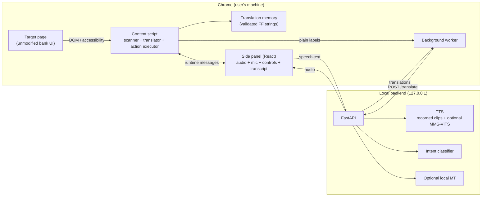

# Architecture

## Overview



There is no cloud component. The only network calls are to `127.0.0.1`.

The content script owns the DOM pass. When the panel's local-API mode is not
`off`, the background service worker asks `POST /translate` for **plain
translatable strings only**; mixed label/value nodes are never sent. The API
targets enter a runtime layer on the translation memory and still go through the
same integrity checks before a node is written.

## Components

### Content script

- Walks the DOM and the accessible-name layer.
- Collects text nodes and classifies them as `translatable`, `mixed`, `protected` or `ignore`.
- Builds an in-memory vault of **value substrings**, not whole label/value sentences:
  amounts, names, phones, accounts, references, dates, error codes, user input, brands and
  currencies.
- Applies translation from the validated translation memory, preserving whitespace and
  protecting values. With the local-API mode enabled, a runtime layer can supply targets for
  plain nodes and for mixed nodes whose values were replaced by `[[Z1]]` placeholders.
- Verifies every protected value and every mixed-node capture after the pass. A mismatch
  restores the page and aborts the plan.
- Captures a page-coverage baseline at Start: every visible letter-bearing text node. The
  panel reports both translatable coverage and page coverage, plus the protected-value floor
  and the safe ceiling.
- Builds a structured page brief (page kind, purpose sentence, section headings, warnings and
  primary actions) for the audio summary instead of reading the flat sentence list.
- Announces a clicked action with its translated name. High-risk clicks are still paused and
  require confirmation.
- Makes a second pass idempotent: an already translated node is counted, a node that renders
  the source again is re-translated, and a node with new text is treated as a new source.
- Observes mutations and re-applies after client-side re-renders.
- Builds a **spoken summary**, not a full read: the step, the important facts, the
  warnings and up to three actions. A sentence that contains a protected value is
  excluded from the TTS payload; the panel tells the user to verify it on screen.
- Exposes **guided** actions to the side panel. `Vérifier` announces the action name aloud and
  asks for confirmation; only `Confirmer` scrolls and focuses the page action. The extension
  never clicks it, never checks a confirmation box and never submits.
- Captures action names before translation, so a translated button keeps its original risk.
- Restores the original page on Stop.

### Translation memory

Two artefacts, one validation workflow:

| Artefact | Key | Used for |
|---|---|---|
| Translation memory (`entries/tm.yaml`) | Normalized FR/EN source string | In-page text replacement |
| Phrase bank (`entries/phrases.yaml`) | Phrase ID + slots | Spoken plans |

The translation memory supports exact strings and mixed patterns such as
`Numéro de compte : {account}`. A mixed pattern may only replace a node if the captured
value substrings remain byte-identical in the target.

#### Runtime local MT

`TranslationMemory` has an in-memory runtime layer. It is filled by the background
service worker from `POST /translate` and is never persisted. The panel persists the mode
(`off`, `fallback`, `primary`) and provider (`auto`, `nllb`, `ollama`). In `fallback`, a
validated unit always wins and the API only fills plain misses. In `primary`, the runtime
layer is checked first. The runtime layer is cleared on Start and Stop.

Plain `translatable` nodes are collected directly. `mixed` nodes are collected only after
their values are replaced with `[[Z1]]` placeholders; the values are restored byte-for-byte
only when every placeholder survives. `protected` nodes are never sent. The API target is
still checked by the free-value and mixed-value rules; a mismatch restores the page and
aborts.

### Side panel

- Start / translate / rescan / stop.
- Coverage of translatable text, translated, protected and missed counts.
- Current step (1/5), page language (FR/EN) and the list of sentences with their original and
  target text.
- Verbatim protected values and a guided action list with risk and locked checkboxes.
- Read-back of the exact amount, fee, total, beneficiary, phone, reference and operation.
- Audio controls, enabled only when the local backend exposes a real voice; the stub silence is
  labelled and never presented as Fulfulde.
- French/English/Fulfulde UI, stored locally in `chrome.storage.local`. The Fulfulde option is
  a machine-translated draft, labelled **Fulfulde (MT)**, and never re-translates the page.
- Page brief with page identity, purpose, sections, warnings and primary actions; click
  announcements use the translated action name.
- "Rien — traitement local" privacy badge, visible without scrolling.

### Local API

| Endpoint | Purpose | Scaffold behaviour |
|---|---|---|
| `GET /health` | Liveness, active providers and readiness reasons | Real |
| `GET /version` | Versions and the cloud switch | Real |
| `GET /providers` | Provider catalogue with `ready`, `reason`, licence and credential variable | Real |
| `POST /providers/reload` | Drop cached model instances | Real |
| `POST /tts` | Text → WAV/MP3, provider selected by config or request | Stub silence until a voice is installed |
| `POST /asr` | Audio → closed-set intent | `UNKNOWN`, confidence 0 |
| `POST /translate` | FR/EN → FF, provider selected by config or request | Real when NLLB/Ollama is configured; the stub returns the source unchanged |
| `GET /phrasebank` | TM/phrase counts, warnings and release gate | Real; `?full=true` returns entries |
| `POST /phrasebank/reload` | Re-read the YAML after an edit | Real |
| `GET /metrics` | Request counts and latency | Real |
| `POST /demo/reset` | Clear metrics | Real |

Providers are `stub`, `ollama`, `nllb`, `marian` and `google` for translation,
and `stub`, `mms`, `camb` and `elevenlabs` for speech. Cloud providers are
refused unless `ZTEAM_ALLOW_CLOUD=1`. See [`MODELS.md`](MODELS.md) and
[ADR 0011](decisions/0011-configurable-model-providers.md).

## Translation pipeline

```
page mount
  → collect visible text nodes
  → normalize + detect language
  → classify protected / mixed / translatable / ignore
  → TM lookup (exact FR, exact EN, mixed pattern)
  → if enabled: background worker asks the local API for plain misses and masked mixed nodes
  → runtime TM layer (never persisted)
  → reject a target that adds a value not in the source
  → write translation (preserving whitespace)
  → build page brief + page coverage (baseline vs current)
  → verify protected values and mixed captures byte-for-byte
  → on failure: restore every changed node and abort
  → report coverage, sentences, protected values and step
```

### Protected-node rule

A node is protected when:

1. its normalized content equals a vault value;
2. it matches a money, phone, account, reference, date, error-code or long-digit pattern;
3. it is user input or contenteditable;
4. it is inside `script`, `style`, `code`, `pre`, `svg`, `canvas`, `textarea` or `input`.

Normalization for comparison: NFKC, lowercase, strip `fcfa`/`xaf`/`f cfa`, strip spaces
(including NBSP and narrow NBSP), commas, dots and apostrophes. A standalone currency token
such as `FCFA` keeps `fcfa` as its vault key.

A mixed node is rewritten only by a validated pattern, or by an exact entry whose target
contains every required vault value **byte-for-byte**. Every captured value is checked again
after the write. A target may not introduce a value that is not in the source.

### Re-render handling

The page is client-rendered. Vue may replace text nodes at any time. The content script:

- observes `childList`, `subtree` and `characterData` with an 80 ms debounce;
- disconnects the observer while it writes, to avoid feedback loops;
- re-applies the translation to new or reset nodes, and counts an already translated node
  instead of treating its target as a miss;
- builds the vault from the original text, never from its own output;
- keeps originals in a `WeakMap` and a changed-node set so Stop restores the page.

### Coverage

`coverage = translated / (translated + missed)` for translatable nodes. The repository's
`scripts/coverage.ts` computes a related metric from two text dumps: the share of baseline
nodes that are no longer present verbatim after translation. Both are internal acceptance
metrics, not claims about general translation quality.

## Speech

The demo voice is recorded audio from a consenting native speaker. The fine-tuned
MMS/VITS track is parallel and documented in `docs/TTS_REPORT.md`. The local API exposes a
stub until the speech extra and model are installed.

## Voice input

Closed-set intent classification (12 commands), not open transcription. The dataset,
training and evaluation plan are described in `docs/LINGUISTIC_VALIDATION.md` and the
project plan. The scaffold exposes the `/asr` endpoint and the microphone permission test,
but the classifier is not wired yet.

## Failure modes

| Failure | Behaviour |
|---|---|
| TM miss | Leave source, count as missed, flag in panel |
| Mixed value missing | Revert all changed nodes, abort, show the abort reason |
| Target introduces a value | Revert all changed nodes, abort, show the abort reason |
| Protected-node change | Revert all changed nodes, abort, show warning |
| Layout truncation | Revert offending node, log, human review |
| New warning/error | Leave the original visible if no validated phrase exists; a plain node may use the labelled local MT fallback |
| Local API offline | Keep the validated TM result; leave plain misses in source and mark the API unavailable |
| Local API target fails integrity | Revert all changed nodes, abort, show the abort reason |
| TTS stub | Label “silence, not Fulfulde”; disable the read button |
| TTS failure / backend down | No crash; translation stays in place |
| Page navigation | New scan, previous plan invalidated |

## Browser test harness

- `eval/pages/journey/` is a local five-step mock with a different DOM from the live page.
- `node scripts/serve-eval.mjs` serves it on `127.0.0.1:4173`.
- `pnpm build:test` generates a fixture TM (`⟦FF:<id>⟧` plus the source strings), builds the
  extension to `apps/extension/.output-test/` and is never packaged.
- `pnpm e2e` runs the local journey, English page, novel content, errors, keyboard and axe tests.
- `pnpm check:live` runs the same mechanics against `https://safinum.cm/hackathon-test` with the
  fixture build. It is a manual/nightly check, not a CI dependency.
- The production build has empty validated Fulfulde targets. With the local-API mode off it
  leaves the source page intact and shows the “no pack” warning; with the fallback on it writes
  labelled NLLB output for plain nodes.

## General pages

The runtime is not tied to the SAFINUM DOM. On a page outside the manifest
matches, the panel requests the site permission, injects the built content
script and sends the same messages. The scanner uses text nodes, roles and
accessible names, not bank-specific selectors.

The production translation memory is domain-scoped. When a page string has no
validated entry, production leaves the source visible and flags it as missed, or
uses the labelled local-API fallback for a plain node when that mode is enabled.
The **test fixture** adds a generic fallback (`⟦FF:novel⟧ <source>`) so a
30-page canary sweep can prove that every non-sensitive node reaches the
replacement path without inventing Fulfulde. The fixture build alone declares
`<all_urls>`; the production manifest stays narrow and the package script
refuses a broad-host or token-bearing build.

The canary block contains an amount, account, phone, reference, date, name,
user input and contenteditable text. A page passes only when the labels and
page text changed, every canary value stayed byte-identical, the input and
contenteditable text stayed unchanged, the pass reported no abort and Stop
restored the page.

## Limits

- Closed shadow roots and canvas-only interfaces are not readable.
- The translation memory covers the demo domain, not general Fulfulde.
- Local MT is optional, never used for mixed/protected nodes, and is always labelled
  machine translation. It is not native-speaker validation.
- The first local-API pass takes about 10–16 seconds for the 25-string mock on CPU. The panel
  shows progress; a rescan reuses the in-memory cache.
- The stub TTS is silence and must not be presented as speech.
- The production build has no validated Fulfulde targets until the native-speaker pack lands.
  With the API fallback on, plain labels show NLLB output marked **MT — non validée**; with it
  off, the page stays in French or English. Neither case is a validated-pack claim.
- Cross-origin iframes, closed shadow roots, canvas/SVG-only interfaces, input
  placeholders and `aria-label` attributes are not part of the text-node
  replacement contract.
- The broad-host fixture build is test-only and is rejected by the production
  package guard.
