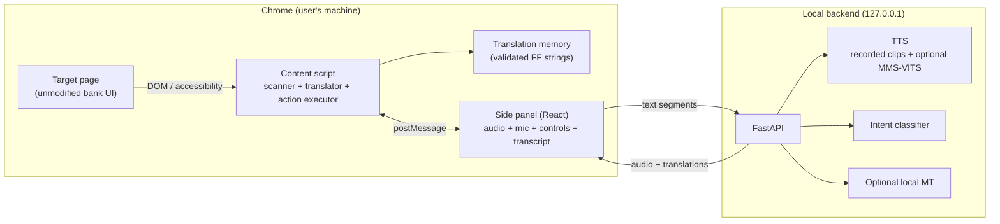

# Architecture

## Overview



There is no cloud component. The only network calls are to `127.0.0.1`.

## Components

### Content script

- Walks the DOM and the accessible-name layer.
- Collects text nodes and classifies them as `translatable`, `mixed`, `protected` or `ignore`.
- Builds an in-memory vault of **value substrings**, not whole label/value sentences:
  amounts, names, phones, accounts, references, dates, error codes, user input, brands and
  currencies.
- Applies translation from the translation memory, preserving whitespace and protecting values.
- Verifies every protected value and every mixed-node capture after the pass. A mismatch
  restores the page and aborts the plan.
- Makes a second pass idempotent: an already translated node is counted, a node that renders
  the source again is re-translated, and a node with new text is treated as a new source.
- Observes mutations and re-applies after client-side re-renders.
- Exposes **guided** actions to the side panel. `Montrer` scrolls and focuses the page action;
  the extension never clicks it, never checks a confirmation box and never submits.
- Captures action names before translation, so a translated button keeps its original risk.
- Restores the original page on Stop.

### Translation memory

Two artefacts, one validation workflow:

| Artefact | Key | Used for |
|---|---|---|
| Translation memory (`entries/tm.yaml`) | Normalized FR/EN source string | In-page text replacement |
| Phrase bank (`entries/phrases.yaml`) | Phrase ID + slots | Spoken plans |

The translation memory supports exact strings and mixed patterns such as
`Numéro de compte : {account}`. A mixed pattern may only replace a node if the captured
value substrings remain byte-identical in the target.

### Side panel

- Start / translate / rescan / stop.
- Coverage of translatable text, translated, protected and missed counts.
- Current step (1/5), page language (FR/EN) and the list of sentences with their original and
  target text.
- Verbatim protected values and a guided action list with risk and locked checkboxes.
- Read-back of the exact amount, fee, total, beneficiary, phone, reference and operation.
- Audio controls, enabled only when the local backend exposes a real voice; the stub silence is
  labelled and never presented as Fulfulde.
- French/English UI, stored locally in `chrome.storage.local`.
- "Rien — traitement local" privacy badge, visible without scrolling.

### Local API

| Endpoint | Purpose | Scaffold behaviour |
|---|---|---|
| `GET /health` | Liveness and backend mode | Real |
| `GET /version` | Versions | Real |
| `POST /tts` | Text → WAV | Silent 0.2 s WAV, `X-ZTeam-Stub: 1` |
| `POST /asr` | Audio → intent | `UNKNOWN`, confidence 0 |
| `POST /translate` | Novel text → FF | Returns source unchanged, `translated: false` |
| `GET /metrics` | Request counts and latency | Real |
| `POST /demo/reset` | Clear metrics | Real |

## Translation pipeline

```
page mount
  → collect visible text nodes
  → normalize + detect language
  → classify protected / mixed / translatable / ignore
  → TM lookup (exact FR, exact EN, mixed pattern)
  → reject a target that adds a value not in the source
  → write translation (preserving whitespace)
  → verify protected values and mixed captures byte-for-byte
  → on failure: restore every changed node and abort
  → report coverage, sentences, protected values and step
```

### Protected-node rule

A node is protected when:

1. its normalized content equals a vault value;
2. it matches a money, phone, account, reference, date, error-code or long-digit pattern;
3. it is user input or contenteditable;
4. it is inside `script`, `style`, `code`, `pre`, `svg`, `canvas`, `textarea` or `input`.

Normalization for comparison: NFKC, lowercase, strip `fcfa`/`xaf`/`f cfa`, strip spaces
(including NBSP and narrow NBSP), commas, dots and apostrophes. A standalone currency token
such as `FCFA` keeps `fcfa` as its vault key.

A mixed node is rewritten only by a validated pattern, or by an exact entry whose target
contains every required vault value **byte-for-byte**. Every captured value is checked again
after the write. A target may not introduce a value that is not in the source.

### Re-render handling

The page is client-rendered. Vue may replace text nodes at any time. The content script:

- observes `childList`, `subtree` and `characterData` with an 80 ms debounce;
- disconnects the observer while it writes, to avoid feedback loops;
- re-applies the translation to new or reset nodes, and counts an already translated node
  instead of treating its target as a miss;
- builds the vault from the original text, never from its own output;
- keeps originals in a `WeakMap` and a changed-node set so Stop restores the page.

### Coverage

`coverage = translated / (translated + missed)` for translatable nodes. The repository's
`scripts/coverage.ts` computes a related metric from two text dumps: the share of baseline
nodes that are no longer present verbatim after translation. Both are internal acceptance
metrics, not claims about general translation quality.

## Speech

The demo voice is recorded audio from a consenting native speaker. The fine-tuned
MMS/VITS track is parallel and documented in `docs/TTS_REPORT.md`. The local API exposes a
stub until the speech extra and model are installed.

## Voice input

Closed-set intent classification (12 commands), not open transcription. The dataset,
training and evaluation plan are described in `docs/LINGUISTIC_VALIDATION.md` and the
project plan. The scaffold exposes the `/asr` endpoint and the microphone permission test,
but the classifier is not wired yet.

## Failure modes

| Failure | Behaviour |
|---|---|
| TM miss | Leave source, count as missed, flag in panel |
| Mixed value missing | Revert all changed nodes, abort, show the abort reason |
| Target introduces a value | Revert all changed nodes, abort, show the abort reason |
| Protected-node change | Revert all changed nodes, abort, show warning |
| Layout truncation | Revert offending node, log, human review |
| New warning/error | Leave the original visible if no validated phrase exists; never MT |
| TTS stub | Label “silence, not Fulfulde”; disable the read button |
| TTS failure / backend down | No crash; translation stays in place |
| Page navigation | New scan, previous plan invalidated |

## Browser test harness

- `eval/pages/journey/` is a local five-step mock with a different DOM from the live page.
- `node scripts/serve-eval.mjs` serves it on `127.0.0.1:4173`.
- `pnpm build:test` generates a fixture TM (`⟦FF:<id>⟧` plus the source strings), builds the
  extension to `apps/extension/.output-test/` and is never packaged.
- `pnpm e2e` runs the local journey, English page, novel content, errors, keyboard and axe tests.
- `pnpm check:live` runs the same mechanics against `https://safinum.cm/hackathon-test` with the
  fixture build. It is a manual/nightly check, not a CI dependency.
- The production build has empty Fulfulde targets, leaves the source page intact and shows the
  “no pack” warning in the panel.

## General pages

The runtime is not tied to the SAFINUM DOM. On a page outside the manifest
matches, the panel requests the site permission, injects the built content
script and sends the same messages. The scanner uses text nodes, roles and
accessible names, not bank-specific selectors.

The production translation memory is domain-scoped. When a page string has no
validated entry, production leaves the source visible and flags it as missed.
The **test fixture** adds a generic fallback (`⟦FF:novel⟧ <source>`) so a
30-page canary sweep can prove that every non-sensitive node reaches the
replacement path without inventing Fulfulde. The fixture build alone declares
`<all_urls>`; the production manifest stays narrow and the package script
refuses a broad-host or token-bearing build.

The canary block contains an amount, account, phone, reference, date, name,
user input and contenteditable text. A page passes only when the labels and
page text changed, every canary value stayed byte-identical, the input and
contenteditable text stayed unchanged, the pass reported no abort and Stop
restored the page.

## Limits

- Closed shadow roots and canvas-only interfaces are not readable.
- The translation memory covers the demo domain, not general Fulfulde.
- Local MT is optional and never used for high-risk content.
- The stub TTS is silence and must not be presented as speech.
- The production build has no Fulfulde targets until the native-speaker pack is validated. The
  page then stays in French or English; this is a pack gap, not a translation claim.
- Cross-origin iframes, closed shadow roots, canvas/SVG-only interfaces, input
  placeholders and `aria-label` attributes are not part of the text-node
  replacement contract.
- The broad-host fixture build is test-only and is rejected by the production
  package guard.
