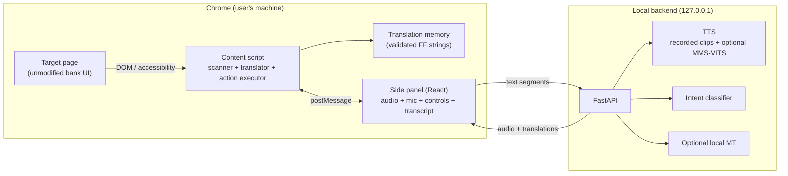

# Architecture

## Overview



There is no cloud component. The only network calls are to `127.0.0.1`.

## Components

### Content script

- Walks the DOM and the accessible-name layer.
- Collects text nodes and classifies them as `translatable`, `mixed`, `protected` or `ignore`.
- Builds an in-memory vault of financial values, names, phones, accounts, references, dates
  and user input.
- Applies translation from the translation memory, preserving whitespace and protecting values.
- Observes mutations and re-applies after client-side re-renders.
- Exposes actions (click/input/select) to the side panel, with a stale-action guard and a
  confirmation gate for high-risk actions.
- Restores the original page on Stop.

### Translation memory

Two artefacts, one validation workflow:

| Artefact | Key | Used for |
|---|---|---|
| Translation memory (`entries/tm.yaml`) | Normalized FR/EN source string | In-page text replacement |
| Phrase bank (`entries/phrases.yaml`) | Phrase ID + slots | Spoken plans |

The translation memory supports exact strings and mixed patterns such as
`Numéro de compte : {account}`. A mixed pattern may only replace a node if the captured
value substrings remain byte-identical in the target.

### Side panel

- Start / translate / rescan / stop.
- Coverage, translated, protected and missed counts.
- Audio playback (recorded clips; stub backend in the scaffold).
- Push-to-talk (classifier is a later milestone).
- "Ce qui quitte cette page : rien — traitement local."

### Local API

| Endpoint | Purpose | Scaffold behaviour |
|---|---|---|
| `GET /health` | Liveness and backend mode | Real |
| `GET /version` | Versions | Real |
| `POST /tts` | Text → WAV | Silent 0.2 s WAV, `X-ZTeam-Stub: 1` |
| `POST /asr` | Audio → intent | `UNKNOWN`, confidence 0 |
| `POST /translate` | Novel text → FF | Returns source unchanged, `translated: false` |
| `GET /metrics` | Request counts and latency | Real |
| `POST /demo/reset` | Clear metrics | Real |

## Translation pipeline

```
page mount
  → collect visible text nodes
  → normalize + detect language
  → classify protected / mixed / translatable / ignore
  → TM lookup (exact FR, exact EN, mixed pattern)
  → write translation (preserving whitespace)
  → verify protected nodes
  → report coverage
```

### Protected-node rule

A node is protected when:

1. its normalized content equals a vault value;
2. it matches a money, phone, account, reference, date or long-digit pattern;
3. it is user input or contenteditable;
4. it is inside `script`, `style`, `code`, `pre`, `svg`, `canvas`, `textarea` or `input`.

Normalization for comparison: NFKC, lowercase, strip `fcfa`/`xaf`/`f cfa`, strip spaces
(including NBSP and narrow NBSP), commas, dots and apostrophes.

Mixed nodes are rewritten only through a validated pattern, and only if every captured
value is still present in the target after normalization.

### Re-render handling

The page is client-rendered. Vue may replace text nodes at any time. The content script:

- observes `childList`, `subtree` and `characterData` with an 80 ms debounce;
- disconnects the observer while it writes, to avoid feedback loops;
- re-applies the translation to new or reset nodes;
- keeps originals in a `WeakMap` so Stop restores the page.

### Coverage

`coverage = translated / (translated + missed)` for translatable nodes. The repository's
`scripts/coverage.ts` computes a related metric from two text dumps: the share of baseline
nodes that are no longer present verbatim after translation. Both are internal acceptance
metrics, not claims about general translation quality.

## Speech

The demo voice is recorded audio from a consenting native speaker. The fine-tuned
MMS/VITS track is parallel and documented in `docs/TTS_REPORT.md`. The local API exposes a
stub until the speech extra and model are installed.

## Voice input

Closed-set intent classification (12 commands), not open transcription. The dataset,
training and evaluation plan are described in `docs/LINGUISTIC_VALIDATION.md` and the
project plan. The scaffold exposes the `/asr` endpoint and the microphone permission test,
but the classifier is not wired yet.

## Failure modes

| Failure | Behaviour |
|---|---|
| TM miss | Leave source, count as missed, flag in panel |
| Protected-node change | Revert node, abort plan, show warning |
| Layout truncation | Revert offending node, log, human review |
| New warning/error | Validated safe phrase, original text visible |
| TTS failure | Recorded fallback phrase |
| Backend down | Cached/recorded audio, no crash |
| Page navigation | New scan, previous plan invalidated |

## Limits

- Closed shadow roots and canvas-only interfaces are not readable.
- The translation memory covers the demo domain, not general Fulfulde.
- Local MT is optional and never used for high-risk content.
- The stub TTS is silence and must not be presented as speech.
