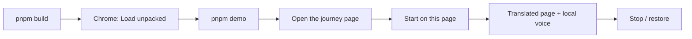

# Try the extension locally

This is the complete, beginner-level walkthrough: build the extension, load it in
Chrome, start the local API and the demo bank page, run the five-step journey,
and switch the local Fulfulde mode without touching code.

Use fictional demo data only. The mock page already uses fake values.

## What you are running

Two things work together:

1. **The Chrome extension** scans the visible page, classifies every text node,
   protects financial values, rewrites plain labels and restores the page on
   Stop.
2. **The local FastAPI service** on `127.0.0.1:8000–8010` provides the voice and,
   when enabled, local NLLB machine translation. Nothing leaves the machine.

The extension never changes the bank's code and never sends page data to a cloud
service.



## The 60-second path

```bash
cd ~/Projects/Z-Team/z-team-fulfulde
pnpm build
pnpm demo        # leave this terminal open
```

In Chrome:

1. Open `chrome://extensions`.
2. Turn on **Developer mode**.
3. Click **Load unpacked**.
4. Select `zteam-extension-demo/production-build` in your home folder
   (for example `~/zteam-extension-demo/production-build`) or
   `apps/extension/.output/chrome-mv3`.
5. Open `http://127.0.0.1:4173/journey/` (run `pnpm serve:eval` if it is not
   already running).
6. Click the **Z-Team Fulfulde Assistant** toolbar icon.
7. Click **Démarrer sur cette page**.
8. The panel shows progress, then **MT local — non validée** and the API count.
9. Click **Arrêter / restaurer** to put the French page back.

## What was verified on this machine

- Build and load in Google Chrome 156; automated five-step runs in Playwright
  Chromium.
- Production build with the local NLLB API: **24 API translations** on the
  balance step, amounts, names and account numbers unchanged, page coverage
  **58%** with a **60% safe ceiling** (17 protected values cannot change).
- Page coverage reaches the safe ceiling on the other steps: **65% fees,
  74% beneficiary, 64% summary, 64% confirmation**.
- Mixed label/value nodes translate through masked placeholders: the model never
  receives the name or account number, and the displayed value is restored
  byte-for-byte.
- The panel switches to Fulfulde without re-translating the page; the FF UI is
  marked as a machine-translated draft.
- The summary reads the page purpose, section headings and primary actions; a
  clicked action is announced with its translated name.
- The audio plan is built from Fulfulde strings regardless of the panel
  language, with a guard that drops any remaining French/English item. TTS
  payloads for all five steps were checked with **no French/English line**.
- Full five-step journey with MT enabled: **no integrity abort**, every amount,
  phone, reference and name still exact; 0 compromised submission entries.
- Mode **Désactivée**: page stays French, zero API calls.
- **Stop during the API batch**: page restored, no partial API text left behind.
- Explicit **NLLB** provider: works.
- Fixture e2e: **14 tests passed**, including accessibility, FF switch, click
  announcements and overflow.
- Unit tests: 83 translator, 43 extension, 8 shared.

The automated browser runs used Playwright's Chromium. The Chrome extension page
screenshot was captured from the installed Google Chrome 156.

## 1. Prerequisites

Already installed on this machine:

- Node 24 and pnpm 11.9.
- Python 3.13 and `uv`.
- Google Chrome 156.
- The repo dependencies and the local models.

On a fresh clone:

```bash
cd ~/Projects/Z-Team/z-team-fulfulde
pnpm install
uv sync --project apps/server --extra dev
```

For the optional speech stack:

```bash
uv sync --project apps/server --extra speech
pnpm setup:e2e       # Chromium for Playwright, once per machine
```

## 2. Build the extension

A "build" compiles the TypeScript/React sources and the phrasebank into a folder
that Chrome can load. The folder contains `manifest.json`, the service worker,
the content script, the side panel, icons and audio assets. You never open an
HTML file directly.

### Production build

```bash
pnpm build
```

Output:

```text
apps/extension/.output/chrome-mv3
```

This is the real extension. It uses the validated translation memory first. When
no validated entry exists and the local-API mode is enabled, it can use the
local NLLB service. Machine output is always labelled **MT — non validée**.

The checked-in translation memory still has empty Fulfulde targets, so without
the API the page stays in French or English and the panel says the validated
pack is missing. That is intentional; the project does not invent translations.

### Test / fixture build

```bash
pnpm build:test
```

Output:

```text
apps/extension/.output-test/chrome-mv3
```

This build replaces every string with a visible `⟦FF:<id>⟧` marker plus the
source. It proves scanning, rewriting, value protection, revert and re-render
handling. It is **not Fulfulde** and it disables the local-API fallback so the
e2e tests stay deterministic. Never present it as a language demo.

### Ready-to-load copies

The build folders start with a dot (`.output`, `.output-test`), and Chrome's file
picker hides dot-folders by default. Copies are kept here:

```text
~/zteam-extension-demo/production-build
~/zteam-extension-demo/test-build
```

After a rebuild, refresh them:

```bash
~/zteam-extension-demo/refresh.sh
```

Then click the circular **Reload** arrow on the extension card in
`chrome://extensions`.

## 3. Load it in Chrome

1. Type `chrome://extensions` in the address bar.
2. Turn on **Developer mode** in the top-right corner.
3. Click **Load unpacked**.
4. Select the folder that **directly contains `manifest.json`**:
   - production: `~/zteam-extension-demo/production-build`
   - fixture: `~/zteam-extension-demo/test-build`
5. Chrome may show **"Review 1 extension that may be unsafe"** or **"Chrome
   can't verify where this extension comes from."** This is normal for any
   unpacked local build. Do not click Remove.
6. Pin the extension: puzzle-piece icon → pin **Z-Team Fulfulde Assistant**.

Load one build at a time. If you load both, they have the same name and two
identical toolbar icons.

> The screenshots used during development are kept locally in
> `~/zteam-extension-demo/screenshots/`. They are intentionally gitignored and
> are not part of the GitHub repository.

## 4. Start the local API and the demo page

Terminal 1 — API, voice and NLLB:

```bash
pnpm demo
```

It reuses a Z-Team API already running on `8000–8010`, otherwise starts on the
first free port. It waits for `/health` and prewarms the demo phrases. Keep the
terminal open.

Fast UI-only alternative:

```bash
pnpm demo:stub
```

The stub voice is silence and the stub translator returns the source unchanged.
Use it to check the panel, not to judge Fulfulde.

Terminal 2 — demo bank page:

```bash
pnpm serve:eval
```

Open:

```text
http://127.0.0.1:4173/journey/
```

Check the API at any time:

```bash
curl -s http://127.0.0.1:8000/health
```

## 5. Use the five-step journey

1. Open `http://127.0.0.1:4173/journey/`.
2. Click the Z-Team toolbar icon. The side panel opens on the right.
3. Click **Démarrer sur cette page**. On a site outside the declared origins it
   may say **Activer sur ce site**; accept the Chrome permission prompt.
4. The badge turns **ACTIF**. The panel shows coverage, translated, protected and
   missed counts.
5. In the **Traduction** card, check the mode and the API count.
6. Move through the steps: balance, fees, beneficiary, summary, confirmation.
   The extension never clicks, checks or submits anything for you.
7. Click **Arrêter / restaurer**. The French page returns and audio stops.

The demo is fictional:

- balance `175 000 FCFA`
- account `CM 999 8887 7776 55`
- beneficiary `Aïssatou Bello`
- phone `+237 6 77 88 99 00`
- reference `SAF-2026-TEST01`

These values must stay byte-identical.

## 6. The local Fulfulde mode

The production build can ask the local API for Fulfulde when the validated
translation memory has no entry. This is configurable in the panel and persists
in `chrome.storage.local` — no code change, no rebuild.

### Modes

| Mode | Behaviour |
| --- | --- |
| **Désactivée (TM validée)** | Validated TM only. This is the old production behaviour: the page stays source if the pack is empty. |
| **Repli après la TM** *(default)* | Validated TM first. Plain labels with no TM entry go to the local API. |
| **API locale d’abord** | The API is asked first, even for strings that have a validated TM entry. The TM is the fallback when the API is unavailable. |

### Provider

| Provider | Behaviour |
| --- | --- |
| **Auto (API)** | Uses the API's configured default (`ZTEAM_MT_BACKEND`). |
| **NLLB local** | Forces the local NLLB provider for this batch. |
| **Ollama local** | Forces the local Ollama provider if it is installed and reachable. |

You can also switch the server default without touching extension code:

```bash
# in .env or the shell before pnpm demo
ZTEAM_MT_BACKEND=nllb
ZTEAM_MT_BACKEND=ollama
ZTEAM_MT_BACKEND=stub
```

Restart the API after changing `.env`. The panel discovers the same range.

### What is sent, and what never is

Only **plain translatable nodes** are sent. A node is excluded when it is
classified as `mixed`, `protected` or `ignore`.

Never sent to the API:

- amounts, fees, totals, balances;
- names and beneficiary names;
- phone numbers, account numbers and references;
- dates and error codes;
- user input, inputs, textareas and contenteditable text.

A mixed label/value node stays in French unless a validated TM pattern covers it.
That is why `Bonjour, Aïssatou` stays French: sending it to NLLB changed
`Aïssatou` to `Aissatou`. Preserving the name is more important than translating
the greeting.

### What you see in the panel

- **Traduits** — total applied strings.
- **TM validée** — applied strings from the bundled validated memory.
- **API locale** — applied strings from NLLB/Ollama.
- **MT local · non validée** — amber badge whenever API output is on the page.
- A warning: machine output is not validated by a native speaker.
- A **TM**, **MT** or **TEST** chip on each sentence row.
- **Manquants** — plain or mixed strings with no target. Mixed values count as
  missed when no validated pattern exists.

Local screenshots: `17-mt-card.png`, `18-page-local-api.png` and
`19-panel-local-api.png` in `~/zteam-extension-demo/screenshots/`.

### Speed

NLLB-600M sometimes returns English or a repeated form. That is why the panel
labels the whole path **MT — non validée**, and why the native-speaker pack
remains the release gate. Do not present this output as validated Fulfulde.

On this CPU, 25 short strings take about **10–16 seconds** with four requests in
flight. The panel shows `Traduction locale en cours : 8/25` while it works.
A rescan reuses the in-memory cache, so the second pass is much faster.

The first pass is intentionally all-or-nothing: the API targets are collected,
validated, then written. If you press **Arrêter** during the batch, the pass is
cancelled and the page is restored.

### Changing the mode

1. Choose the mode and provider in the **Traduction** card.
2. Click **↻ Rescanner** (or **Démarrer** again if inactive).
3. The change applies on that pass; the hint in the card says so.

Switching to **Désactivée** restores the page to TM/source output on the next
rescan.

## 7. Fixture build versus production build

| Build | Output | Page | Use |
| --- | --- | --- | --- |
| Production | `.output/chrome-mv3` | Validated TM first; optional local NLLB marked MT; source if both unavailable | Real demo, local try |
| Fixture | `.output-test/chrome-mv3` | `⟦FF:…⟧` test markers; API MT disabled | e2e and mechanics tests only |

The fixture is a harness. Its tokens are not Fulfulde. Do not record it as a
language demo.

Local screenshot: `04-page-fixture-translated.png` in
`~/zteam-extension-demo/screenshots/`.

## 8. Read-back and protected values

The panel has a **Valeurs protégées** section and, on the summary step, a
**Récapitulatif à vérifier** card. The read-back shows the exact amount, fee,
total, beneficiary, phone, reference and operation.

Local screenshot: `07-readback-exact-values.png` in
`~/zteam-extension-demo/screenshots/`.

The invariant:

> Amounts, fees, totals, balances, account numbers, phone numbers, references,
> dates, names and user input are byte-identical before and after translation.
> A mismatch reverts the node and aborts the pass.

## Panel language (FR / EN / Fulfulde)

The selector in the top bar changes **only the side panel**. It never rescans,
retranslates or restores the page.

- **FR / EN** are complete interfaces.
- **FF** is a Fulfulde machine-translated draft, labelled **Fulfulde (MT)**.
  The footer note says it still needs native-speaker validation.
- Switching to FF or back leaves the page text exactly as it is.

The FF draft is deliberately marked as MT. Do not present it as a validated
Fulfulde interface until a native speaker has reviewed it.

## Page coverage versus translatable coverage

The panel shows two different percentages:

- **Couverture des textes traduisibles** — translated / (translated + missed) on
  translatable nodes. Protected values are excluded from the denominator.
- **Couverture de la page** — every visible text node in the app content that
  contains a letter, compared with a baseline captured for the current step and
  language. Protected values are included, and they cannot change.

The second number is lower by design. Each protected amount, name, account,
phone, date or reference stays unchanged, so **100% is not a valid target**.
The panel shows a **safe ceiling**: the share of visible texts that is not a
protected-only value. On the live five-step page the run is **58% / 60%** on
the balance step and reaches the ceiling on fees, beneficiary, summary and
confirmation. The mock page run is **67% / 69%** with 11 protected values. That
is effectively the safe maximum for those pages.

## Summary and click announcements

The audio summary is a structured page brief, not the whole page:

1. the page/step identity;
2. a Fulfulde page-purpose line (balance, fees, beneficiary, summary or
   confirmation);
3. the main purpose sentence when it is available;
4. one or more section headings (for example “Transactions récentes”);
5. warnings;
6. the primary actions (transfer, fees, continue, confirm);
7. a note that exact amounts are on screen.

The spoken plan is built from Fulfulde copy **even when the panel is in French
or English**. A guard drops any remaining French/English item, so the voice does
not read a mixed-language sentence. It never reads the whole page and never
reads identifiers aloud.

For example, the summary page audio is:

```text
Taƴre 4/5 — Ɗuɓɓere
Ɗuɓɓere: ndaara anndal yeeso tabitinal.
Jaɓɓorgo Fedde
Hakkiilo
Ɗuɓɓuki
Limɗe, konti e referees ɗee haaletaake: ndaare ɗum e ekran.
```

When you click a page action, the panel announces the translated action name
with the local voice. High-risk actions are paused first and require your
confirmation in the panel; the extension never clicks or submits for you.

## 9. Troubleshooting

| Symptom | Cause and fix |
| --- | --- |
| **Load unpacked** is greyed out | Developer mode is off. Toggle it top-right. |
| Chrome cannot find `.output*` | Dot-folders are hidden. Use `~/zteam-extension-demo/...`, or press `Ctrl+L` in the picker and paste the full path. |
| "Manifest file is missing or unreadable" | You selected the parent folder. Select the folder that directly contains `manifest.json`. |
| Chrome says the extension may be unsafe | Expected for an unpacked build. Keep it; do not click Remove. |
| No toolbar icon | Puzzle-piece icon → pin **Z-Team Fulfulde Assistant**. |
| The side panel does not open | Click the extension icon again, or right-click it → **Open side panel**. |
| **Démarrer** is disabled | The tab is `chrome://`, the Chrome Web Store or another restricted page. Open an `http://` or `https://` page. |
| The page stays French | Mode is **Désactivée**, the API is offline, or the API returned no target. Check the Traduction card and `curl http://127.0.0.1:8000/health`. |
| API count stays 0 | Start `pnpm demo`, wait for health, then click **Rescanner**. |
| First pass feels slow | NLLB runs on CPU; expect 10–16 s for 25 strings. Watch the progress line. |
| API output looks wrong | It is machine translation, not validated Fulfulde. Switch to **Désactivée** or wait for the validated pack. Do not record it as validated. |
| FF panel looks like a draft | It is: **Fulfulde (MT)** is a machine-translated draft. Switch to FR/EN for the complete UI, or wait for native validation. |
| Page coverage is lower than translatable coverage | Page coverage includes protected values, which must not change. Compare it with the **safe ceiling** shown next to it. |
| Provider error after choosing Ollama | Ollama is not running, or its model is missing. Switch to **Auto (API)** or **NLLB local**, or start Ollama. |
| Mixed greeting stays French | Intentional: the name is protected and mixed nodes are never sent. |
| Panel says the pack is missing | The validated TM is empty. Enable **Repli après la TM** with the API running, or install the validated pack. |
| Page shows `⟦FF:...⟧` | Fixture build. Not Fulfulde. |
| Voice buttons are disabled | The API is offline, the voice is a stub, or TTS is not ready. Page text still works. |
| Port 4173 is busy | `pnpm serve:eval -- --port 4175`, then open the new URL. |
| Old version after a rebuild | Click **Reload** on the extension card, then reopen/rescan. |
| Extension disappeared after a Chrome restart | Load it again from the same folder. Keep the folder path stable. |

## 10. Rebuild and development loop

After changing extension code:

```bash
pnpm build
~/zteam-extension-demo/refresh.sh
```

Then `chrome://extensions` → **Reload** → close/reopen the side panel.

For active development:

```bash
pnpm dev
```

Load `apps/extension/.output/chrome-mv3` and keep the terminal open. `pnpm dev`
and `pnpm build` write to the same `.output/chrome-mv3`; do not run them at the
same time.

Fixture loop:

```bash
pnpm build:test
pnpm e2e
```

## 11. Tests and evidence

```bash
pnpm --filter @zteam/translator test
pnpm --filter @zteam/extension test
pnpm --filter @zteam/phrasebank test
pnpm e2e
pnpm ci:local
```

`pnpm e2e` needs Chromium once: `pnpm setup:e2e`.

Optional live checks:

```bash
pnpm check:live   # real SAFINUM page with fixture tokens
pnpm check:sites  # 30 public pages, canary values
```

## 12. Privacy

- The extension talks only to `127.0.0.1` (`8000–8010`).
- With the local API mode enabled, plain translatable labels go to the local
  service. Protected values never do.
- The runtime MT cache is in memory only; it is not written to
  `chrome.storage`.
- `chrome.storage.local` holds the interface language, playback speed and the
  local-API mode/provider. It never holds page values.
- There is no cloud provider, no API key at runtime, no telemetry and no remote
  config.
- No auto-submit. A changed value blocks the action.
- Use fictional data only.

## 13. Files and links

| Path | What it is |
| --- | --- |
| `apps/extension/.output/chrome-mv3` | Production build |
| `apps/extension/.output-test/chrome-mv3` | Fixture build |
| `~/zteam-extension-demo/production-build` | Ready-to-load production copy |
| `~/zteam-extension-demo/test-build` | Ready-to-load fixture copy |
| `~/zteam-extension-demo/screenshots` | All captured screenshots |
| `~/zteam-extension-demo/refresh.sh` | Refresh the two copies after a build |
| `docs/DEMO.md` | Short demo runbook |
| `docs/ARCHITECTURE.md` | Pipeline and components |
| `docs/PRIVACY.md` | Data flow and permissions |
| `docs/decisions/0015-runtime-local-mt-fallback.md` | Why and how the local MT fallback exists |

## 14. What is real and what is not

**Real**

- The browser scanner, in-place rewrite, protected-value pass, revert, re-render
  handling and guided panel.
- The local NLLB model and its HTTP API.
- The local MMS voice baseline (not native-validated).
- The byte-identical value checks.
- Masked mixed-node translation: the API receives placeholders, never the
  displayed values.
- The page coverage metric, the structured page brief and click announcements.

**Not real yet**

- A native-speaker-validated Fulfulde pack. The checked-in `generated.ts` is the
  NLLB draft (`packSource: "mt"`), not a validated pack.
- Native validation of the NLLB output. The panel says **non validée** for a
  reason.
- A native-validated Fulfulde panel. The **FF** option is a machine-translated
  draft, labelled **Fulfulde (MT)**.
- Voice input / ASR. The classifier is a stub.
- The fixture `⟦FF:…⟧` tokens are test markers, not Fulfulde.

Do not claim the machine output is validated Fulfulde. Do not record the fixture
build as a language demo. The validated pack remains the release gate.
