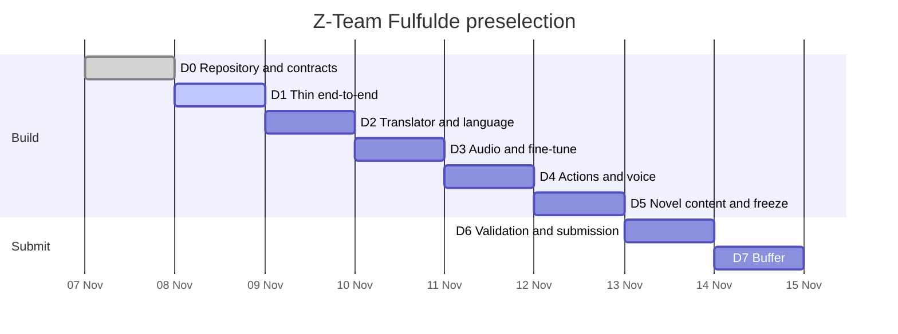

# Project board

The preselection work is tracked in a public GitHub Project:

**<https://github.com/users/Zeusse-Neumbi/projects/4>**

The board is the execution view; the product and contract decisions stay in
[`docs/decisions/`](decisions/README.md) and the repository rules stay in
[`CONTRIBUTING.md`](../CONTRIBUTING.md).

## Timeline

| Day | Date | Focus | Gate |
| --- | --- | --- | --- |
| D0 | Sat 7 Nov | Repository, contracts, string inventory, speaker booking | Repo + contracts + inventory |
| D1 | Sun 8 Nov | Thin end-to-end: scan → translate balance page → speak | Balance page translated + spoken in <1.5 s |
| D2 | Mon 9 Nov | Translator v2, protected nodes, TM v1, phrase bank, verbalizer | 5 pages, 0 value changes, coverage ≥90% |
| D3 | Tue 10 Nov | Audio, cache, prewarm, coverage/visual harness, TTS fine-tune | P95 first audio <1 s; visual clean |
| D4 | Wed 11 Nov | Actions, voice, read-back, confirmation, integrity matrix | Transfer end-to-end, no auto-submit |
| D5 | Thu 12 Nov | Novel content, mock B, EN toggle, accessibility, packaging | Freeze 18:00; ZIP ≤8 MB; zero critical failures |
| D6 | Fri 13 Nov | Native validation, regression, video, note, submission | Form accepted; screenshot kept |
| D7 | Sat 14 Nov | Buffer only | Hard deadline 23:59 Africa/Douala |

**Internal submission:** Friday 13 November 2026, 18:00.
**Freeze:** Thursday 12 November 2026, 18:00.
**Hard deadline:** Saturday 14 November 2026, 23:59 Africa/Douala.



## Views

| View | Layout | Filter | Use |
| --- | --- | --- | --- |
| All items | Table | none | Audit every item and field |
| Roadmap | Roadmap | `is:open` | See the D1–D7 timeline |
| Board | Board | `is:open` | Daily status flow |
| Backlog | Table | `is:open` | Plan area, phase, size and target |
| Blocked | Table | `status:"Blocked"` | Decisions and external dependencies |
| Bugs | Table | `label:"type/bug"` | Defects only |
| Submission | Table | `phase:"D6 Submission"` | Final package |
| Done | Table | `is:closed` | Evidence of what shipped |
| My items | Table | `assignee:@me` | Personal next action |

Roadmap views do not support a visible-field list; every other view is configured
with the columns that matter for its question.

## Fields

| Field | Type | Options / use |
| --- | --- | --- |
| Status | Single select | Todo, In Progress, In Review, Blocked, Done |
| Priority | Single select | P0 critical path, P1 ship in preselection, P2 cut list |
| Area | Single select | Extension, Translator, Phrasebank, API, Speech, Validation, Docs, Repo, Demo |
| Track | Single select | Product, Linguistic, Speech, Submission, Repo |
| Phase | Single select | D0 Setup … D7 Buffer, Post-hackathon |
| Size | Single select | S, M, L |
| Role | Single select | A Extension, B Backend, C Speech, D Product QA, E Linguist |
| Risk | Single select | Low, Medium, High, Critical |
| Target | Date | The day the item must be done for its gate |
| Blocker | Text | The concrete reason an item is Blocked |

The built-in **Status** field is the board column. The built-in **Milestone** and
**Labels** fields are populated from the issue, not by hand.

## Milestones

| Milestone | Due |
| --- | --- |
| D0 — Setup and repository | 7 Nov 2026 |
| D1 — Thin end-to-end | 8 Nov 2026 |
| D2 — Translator and language layer | 9 Nov 2026 |
| D3 — Audio, visual and fine-tune | 10 Nov 2026 |
| D4 — Actions and voice | 11 Nov 2026 |
| D5 — Novel content and freeze | 12 Nov 2026 |
| D6 — Validation and submission | 13 Nov 2026 |
| D7 — Buffer | 14 Nov 2026 |
| Post-hackathon | No date |

## Operating cadence

1. **Morning:** open **Board**, move the day's P0 items to `In Progress`, and
   confirm the gate in the milestone description.
2. **During the day:** put anything waiting on a person, a decision or a model in
   `Blocked` and write the concrete reason in **Blocker**.
3. **Evening:** run the demo, attach evidence to the issue, and move finished
   work to `In Review` or `Done`.
4. **Before merge:** every code change follows `CONTRIBUTING.md` and the
   `ci-required` gate.
5. **At freeze:** only submission-critical or critical-defect fixes; no new
   features.

## Labels

Labels are grouped by prefix:

- `area/*` — the component or evidence area;
- `type/*` — feature, bug, chore, research, test, security;
- `priority/*` — P0, P1, P2;
- `risk/*` — low, medium, high;
- `status/blocked` — mirrors the Blocked status;
- `dependencies`, `hackathon`, `preselection`, `post-hackathon`.

Issues use Conventional Commit-style titles (`feat(...)`, `fix:`, `test:`,
`docs:`, `chore:`). Pull requests use the same convention because the squash
commit inherits the PR title.

## Automation

GitHub's built-in project workflows cannot be created through the GraphQL API.
Enable them once in the project UI:

1. Open the project, then **⋯ → Workflows**.
2. Turn on **Item closed** → set Status to `Done`.
3. Turn on **Pull request merged** → set Status to `Done`.
4. Turn on **Auto-add to project** for this repository, filtered to
   `is:issue` and the `preselection` label.
5. Turn on **Auto-archive items** after 30 days in `Done`.

The local guardrails are separate: `pnpm hooks`, `pnpm ci:local`, the
`ci-required` check and the `main protection` ruleset.

## Reproducible setup

The board is defined as code:

```bash
node scripts/bootstrap-github-project.mjs
```

The script reads [`scripts/project-plan.json`](../scripts/project-plan.json),
reuses an existing project, fields, views, milestones, labels and issues, and
creates only what is missing. It requires the `project` token scope:

```bash
gh auth refresh -s project
```

The script does not delete anything. To rebuild from scratch, delete the project
in the UI first and run it again.

## Non-negotiables

1. Protected values are byte-identical before and after translation.
2. Translation is in-page; audio is the accessibility layer on top.
3. No network egress except `127.0.0.1`.
4. No auto-submit and no bypassed confirmation.
5. Native-speaker validation is recorded as evidence, not claimed.
